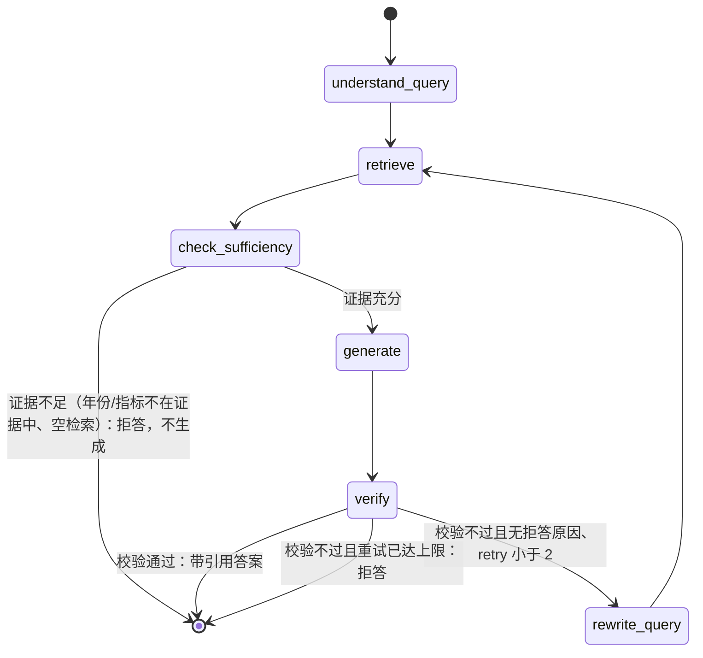

# FinRAG — 金融研报知识库问答系统

[](https://github.com/ASDFGHJKL12345678SZ5/finrag/actions/workflows/ci.yml)

> 项目二（与 DataCrew 电商智能问数**零代码共享、强差异化**）：
> DataCrew 答"数据库里有什么"（结构化数据 / text-to-SQL / 安全闸），
> FinRAG 答"研报里怎么说的"（非结构化文档 / 检索增强生成 / 引用校验）。
> 独立仓库、独立数据库（端口 5433 vs DataCrew 的 5432）、独立镜像。

## 1. 系统架构

客户端两层：**Vue 3 SPA（`frontend/`，端口 5174）经 SSE 消费 `/ask` 事件流；
`ask.py` CLI 打印答案+引用（也当 API 的活文档）。**

```
                ┌──────────────────────────────────────────────┐
                │                  FastAPI (D5)                 │
                │   POST /ask  SSE 流式：节点轨迹+引用+结论      │
                └───────────────────┬──────────────────────────┘
                                    │
                ┌───────────────────▼──────────────────────────┐
                │            LangGraph 问答图 (D5)              │
                │  查询理解 → 混合检索 → 充分性守卫 → 带引用生成 → 引用校验 │
                │                  │ 证据不足 → 拒答（零 LLM 调用）        │
                │                  ▼ 校验不过 → 改写查询重检索（拒答不重试）│
                └───────────────────┬──────────────────────────┘
                                    │
       ┌────────────────────────────┼────────────────────────────┐
       ▼                            ▼                            ▼
┌─────────────┐            ┌────────────────┐            ┌──────────────┐
│  Embedder   │            │  pgvector 检索库 │            │  LLM (D5)    │
│ bge-small-zh│            │ 向量+关键词并集  │            │ DeepSeek/ Mock│
│ 本地 ONNX   │            │ 元数据过滤(行业) │            │              │
└─────────────┘            └────────────────┘            └──────────────┘
       ▲
       │ 入库流水线（app/rag/ingest.py）
┌──────┴──────────────────────────────────────┐
│ 合成研报语料（app/rag/corpus.py）            │
│ Markdown → 结构感知分块 → 向量化 → upsert    │
│ 每条事实登记进 FactRegistry（评测 ground truth）│
└─────────────────────────────────────────────┘
```

**数据流**：语料生成器产研报 + 事实登记表 → 分块器切块（带章节路径元数据）
→ embedder 向量化 → pgvector 入库。问答时查询向量与关键词双路召回、
min-max 归一后加权融合，生成阶段强制引用 chunk，引用校验不过则拒答。

问答状态机图（节点名与 app/rag/graph.py 一致）：



重试环的设计：改写查询时只把 verdict 里的真实缺失证据词（数字/中文实词）
拼回问题——状态词（如无对应引用）拼进去会污染下一轮检索。
拒答是正常终态：宁可说没有依据，也不放行无引用或引用对不上的数字论断。

**守卫的位置（D13 后续修正）**：充分性守卫是**独立节点**
（`check_sufficiency`），插在 retrieve 与 generate 之间，命中即条件边直达 END；
`route_after_verify` 也不再对"有拒答原因"的题重试。早期版把守卫写在 verify
节点入口，而 generate 在 verify 之前——"生成前拒答"只是文档里的说法：
实测错年份问题会 `retrieve → generate → verify 拒答 → rewrite → retrieve → …`
烧掉 **3 次生成**（初次 + 2 次重试），"零 LLM 成本"并不成立。修正后同一问题的
trace 是 `retrieve → check_sufficiency`，**generate 零次执行**。
位置由 `tests/test_graph_integration.py::test_sufficiency_refusal_skips_generate`
（"一调用就炸"的 LLM 探针）与 `::test_拒答路由不重试` 两条测试守死。

## 2. 目录结构

```
app/
  main.py             uvicorn 入口：python -m app.main（端口 8001）
  loops.py            Windows Selector 事件循环（asyncpg 兼容）
  core/config.py      配置（env 驱动，dim 启动自检）
  core/logging.py     结构化 JSON 日志
  rag/chunker.py      结构感知分块器（章节路径/表格保全/滑动窗口）
  rag/embeddings.py   Embedder 协议：本地 ONNX + 确定性 mock
  rag/store.py        pgvector：schema/写入/向量召回/关键词召回
  rag/retrieve.py     混合检索（向量+关键词 IDF 加权）
  rag/graph.py        LangGraph 问答图：理解/检索/重写/生成/校验
  rag/llm.py          DeepSeek 客户端（tenacity 重试 + 进程级单例）
  rag/verify.py       引用校验：数字论断词面回溯（拒答机制）
  rag/sufficiency.py  证据充分性守卫：问题年份/指标不在证据中 -> 检索后、生成前拒答（D13）
  rag/corpus.py       合成研报语料 + FactRegistry + 分级题面（易混干扰/同义改写/无答案题/污染探针）
  rag/ingest.py       入库流水线编排（CLI: python -m app.rag）
  api/main.py         FastAPI：/ask SSE 问答 + /ask/sync + /health
  eval/runner.py      评测 driver：分级指标（exact/paraphrase/refusal/contamination）+ 分策略对比 + 多种子
  eval/schema.py      评测指标定义
ask.py                CLI 问一句并打印答案+引用
frontend/
  package.json        Vue 3 + Vite + vue-router + marked/dompurify + vitest
  src/services/       SSE 解析器（data-only 帧）+ 轮次状态机 reducer + API 客户端
  src/views/          AskView：提问/流式答案/引用面板/校验明细/拒答横幅
  src/components/     CitationsPanel（引用出处）/VerdictsPanel（逐论断裁定）等
  tests/              50 项 vitest 单测（断帧重组/CRLF/多帧粘包/事件机/快照语义/组件与外壳冒烟）
scripts/load_test.py 压测（含 SOCKS 代理选项）
deploy/postgres/init/ 实例级扩展（vector + pg_trgm）
tests/                176 个测试：分块（含表格）/向量契约/语料合法性/检索（倒排/融合/重排）/校验器（边界+单位+多引用+引用修复）/聚合（facts/argmax/词表派生识别）/守卫（独立词典）/评测隔离/API 安全/SSE
```

## 3. 设计决策日志（ADR）

- **ADR-01 向量库用 pgvector 而不是 Chroma/Milvus**：FinRAG 已经有
  postgres（文档元数据、评测结果都存它），向量放同实例不同 schema，
  运维面不扩大；元数据过滤和混合检索（向量+关键词并集）用 SQL 表达最
  直接，不用在应用层缝两个系统。万级-十万级文档 HNSW 完全够，真到千万级
  再迁 Milvus——检索接口是协议，换实现不动上层。
- **ADR-02 embedding 用本地 ONNX 模型（bge-small-zh-v1.5）不用 API**：
  金融语料不出内网；评测要可复现（模型固定→向量固定→检索结果固定）；
  无 key 也能跑全流程。fastembed 比 torch 轻（ONNX Runtime）。保留
  mock 模式（确定性哈希向量）让 CI 不依赖模型下载——mock 测管道通不通，
  不测检索准不准，两者不混用。
- **ADR-03 分块必须结构感知而不是固定长度**：研报是强结构文档，
  "风险提示"标题下第一段永远是风险；固定长度切会把标题和正文切断、
  把两条不同风险并进一块，检索到"半句话"时模型只能编下半句。按标题
  层级切段并携带章节路径元数据，超长段落才按句子滑动
  窗口切（块间重叠缓解边界丢失）。
- **ADR-04 检索用混合（向量+关键词）而不是纯向量**：金融问答有大量
  精确实体（股票代码、指标名、具体数字），纯向量对精确匹配弱。关键词
  路用中文二元组 ILIKE 匹配 + IDF 加权（内置中文分词对中文按整句切、
  recall 差；pg_trgm 索引对 2 字符模式基本无效，关键词路待升级为 BM25 + 预计算 df），
  两路召回 min-max 归一后加权融合。重排（cross-encoder）留到评测
  数据说话后再决定是否引入。
- **ADR-05 语料是合成的，且 ground truth 与语料同源**：真实研报有
  版权风险；合成语料的每个数字都由生成器产出并登记进 FactRegistry，
  评测时逐条可回溯——"答案对不对"有确定来源，不依赖人工标注。固定
  随机种子，语料逐字节可复现。
- **ADR-06 端口 5433、独立数据卷**：与 DataCrew 物理隔离，任何一侧
- **ADR-07 SSE 用 stream_mode=["updates","values"] 一次跑完，绝不 astream 后重跑**：初版 /ask 先 astream("updates") 推节点事件，终态再 await ask() 把完整图**重跑一遍**——一次 SSE 请求两轮 LLM 调用（成本/延迟双倍），且 /ask 与 /ask/sync 并发时 checkpointer 两路写可能把"未初始化"的旧状态读回来。修复后一次 astream 同时拿节点增量（推事件）和全量快照（最后一个即终态）。回归测试 tests/test_sse_single_run.py 把旧入口 ask 换成"一调用就炸"的探针，双跑复发立刻红。
- **ADR-08 HNSW 索引算子类必须与查询运算符一一对应**：查询用 `<=>`（余弦距离），索引就必须是 vector_cosine_ops。曾经索引建成 vector_ip_ops——向量已 L2 归一化时两者数值等价，但 pgvector 的算子类与运算符是绑定关系，计划器直接用不上该索引，万行 chunks 全表扫描。D7 实测（150 行演示库，SET enable_seqscan=off 强制索引）：cosine 索引 → Index Scan，ip 索引 → Seq Scan。小表时规划器自己也会选 Seq Scan，这个 fix 的价值在数据量上来之后。
- **ADR-09 引用校验是结构性的词面校验，不是语义相似**：金融场景幻觉零容忍，但"让 LLM 自己保证不编"不可靠。校验器抽取答案中每个含数字的论断，要求其数字与关键词**词面出现**在它引用的 chunk 文本里；任一论断无依据 -> 整篇降级为"资料不足"拒答。语义相似要再上一个模型，而词面校验对"编数字"这类最高危幻觉已足够（编的数字几乎不可能恰好出现在语料里），且确定、可单测、零依赖。
- **ADR-13 评测分级：100% 是基准的属性，不是系统的能力（D13 重构）**：早期评测集与语料同源到没有难度——30 篇一篇一公司、问题里公司名与指标逐字出现，关键词检索（中文二元组 ILIKE 子查询）必然全中，recall@5=100% 是**结构性必然**；幻觉题又全部撞中 mock 触发词，拒答 100% 是规则假模型的产物（真实模式同题 0.1）。这种基准写进简历等于自曝其假。重构：①语料加**易混公司干扰报告**（同行业共享前缀、不同数字）与**同义改写题**（指标换成语料里没有的写法）；②新增**三类无答案题**（错年份/语料外指标/未来预测，全部不含触发词）与**跨公司污染探针**（问 A 不能答出 B 的数字）；③判据从"源文档命中"升级为**源文档 + 证据块双口径**；④检索加**实体锚定**（问题点到名的公司文档 ×2.0 加权，生产 RAG 的 entity-aware retrieval 标准做法，带消融位）；⑤新增**证据充分性守卫**（`app/rag/sufficiency.py`：问题年份/指标不在证据中 -> 拒答，确定性判据）——它关掉了真实模式拒答率 0.1 的缺口；⑥评测按 exact/paraphrase/refusal/contamination **分档报告 + 多种子均值**，exact 档诚实标注为**管线自检**（小语料 + 实体逐字出现，接近饱和是基准属性，不作为质量声明）。方法论：**基准太容易时要改基准，不是把数字改小**。
- **ADR-14 守卫的位置：拒答必须发生在生成之前，而"写在 verify 里"不等于**（D13 后续修正）：ADR-13 的守卫初版写在 **verify 节点入口**，而 `generate` 在 `verify` 之前——于是"生成前拒答、零 LLM 成本"只是**文档里的说法**：实测错年份问题走的是 `retrieve → generate → verify 拒答 → rewrite_query → retrieve → generate → verify 拒答 → rewrite_query → retrieve → generate → verify 拒答`，**烧掉 3 次生成**（初次 + 2 次重试）。两个根因：①守卫的位置在生成之后；②`route_after_verify` 只看 `status == "done"`，不区分拒答原因，所以"改写查询也救不回来"的题被老老实实重试到底。修正：守卫独立成 `check_sufficiency` 节点插在 `retrieve` 与 `generate` 之间，命中即条件边直达 END；`route_after_verify` 增加"有拒答原因则不重试"。修正后同一问题的 trace 只剩 `retrieve → check_sufficiency`，**generate 零次执行、LLM 零次调用**。**通用的教训：判据写在哪一层，决定了它省不省钱——"我先拒答"必须验证到"生成确实没跑"这一层，而不是看状态字段对不对。** 由两条测试守死：`test_sufficiency_refusal_skips_generate`（把 LLM 换成"一调用就炸"的探针，守卫一旦挪回生成之后立刻红）与 `test_拒答路由不重试`（纯函数级锁死"拒答 = 终态"语义）。
  重建/挂掉不影响另一侧。两个项目的代码也零共享——差异化是刻意的，
  不是懒。

## 4. 当前进度（路线图）

| 天 | 内容 | 状态 |
|---|---|---|
| D4 | 仓库骨架 + 分块/向量/检索/入库 + 合成语料 + 18 测试 | ✅ |
| D5 | LangGraph 问答图：查询理解/混合检索/加权融合/带引用生成 + SSE API + 33 测试 | ✅ |
| D6 | 评测闭环（36 测试）+ 压测 | ✅ |
| D13 | 评测可信度重构：分级基准 + 实体锚定 + 充分性守卫（62 测试） | ✅ |
| D13+ | 守卫位置修正：`check_sufficiency` 独立成节点（检索后、生成前）+ 拒答不重试（62 → **64** 测试：+1 守卫位置探针 +1 拒答路由） | ✅ |
| FR-2/3/5/7/8 | 守卫独立词典 + 评测库隔离/逐题明细 + 表格感知分块 + 校验/改写收紧 + 并发/SSE 超时 + API Key/限流/CORS/Langfuse（**102** 测试） | ✅ |
| FR-1/4/6 | 难基准 200×5=1000 篇/800 题 + 倒排 BM25（df 预计算）+ RRF/rerank 可选（116 测试；mock 总通过 96.6%） | ✅ |
| FR-10/11 | 跨文档聚合（facts 表 + SQL argmax + 图节点）+ 引用自动修复（176 测试；真实 800 题 99.6%） | ✅ |
| D7 | 与 DataCrew 一起收尾（CI/架构图/简历数字核验） | ✅ CI 双 job + Redis service；§1 架构图；简历数字逐项指向 reports/（见 §4.7/§4.8） |

## 4.5 评测结果（D13 分级，可复现）

跑法（每次 run 落库 eval.runs，metrics JSONB 可下钻；多种子用逗号分隔）：
    pwsh:     $env:EMBEDDING_MODE="mock"; python -m app.eval.runner
    pwsh:     $env:FINRAG_EVAL_SEEDS="42,7,2026"; python -m app.eval.runner
    linux:    EMBEDDING_MODE=mock python -m app.eval.runner

**分级设计（为什么早期"全是 100%"必须改，ADR-13）**：早期评测集与语料同源到
没有难度——问题里公司名与指标逐字出现，trigram 子查询必然全中，recall@5=100%
是结构性必然；幻觉题全撞 mock 触发词，拒答 100% 是规则假模型的产物。这种
基准的 100% 不是系统能力。现在分四档报告，判据全部可回溯到 FactRegistry：

| 档 | 内容 | 定位 |
|---|---|---|
| exact | 原题（公司名+指标逐字，114 事实） | **管线自检**——接近饱和是基准属性，不作为质量声明 |
| paraphrase | 同义改写题（"营业收入"→"总收入"，228 题） | 检索语义能力的质量声明 |
| refusal | 三类无答案题（错年份/语料外指标/未来预测，30 题，无触发词） | 拒答能力的质量声明 |
| contamination | 跨公司污染探针（问 A 不答出 B，含锚定消融） | 实体判别能力的质量声明 |

### mock 模式（哈希向量 + 规则假模型；38 篇 / 114 事实 / seed=42）

| 指标 | 数值 | 说明 |
|---|---|---|
| recall@5 vector_only | 8.8%（exact）/ 9.7%（paraphrase） | 随机基线——mock 向量无语义；干扰报告加入后基线比早期 15.6% 更低也更诚实 |
| recall@5 keyword_only | 100% / 100% | trigram 全名匹配是强判别特征（易混公司只共享前缀） |
| recall@5 hybrid | 100% / 100% | 系统当前策略 |
| 证据块命中 keyword_only / hybrid | 100% / 100% | 更严口径：top-k 里要出现**含答案数字的块**，不只是同文档 |
| answer_accuracy | 100% | mock 是证据摘录模型——这是摘录循环，**不是模型能力** |
| citation_faithfulness | 100% | 数字论断被引用证据支持的比例 |
| 拒答率 wrong_year / missing_metric / future_prediction | **100% / 100% / 100%** | 充分性守卫确定性拦截，无触发词依赖；改造前同类真实模式仅 0.1 |
| 污染拦截 anchor off / anchor on | 100% / 100% | 词路全名匹配已能判别时锚定是冗余保险；其价值在向量路参与的融合（真实模式） |
| 延迟 P50 / P95 | ≈28ms / ≈30ms | mock 模式，无 LLM 网络往返 |

**mock 档的诚实解读**：词路在这个语料上饱和，证明的是"管线通 + 判据对"。
含完整实体名的问题，检索是否 100% 由**判据强度**决定——别人的 recall@5
98% 来自数十万文档、无完整实体的自然语言问法；本语料 38 篇 + 实体逐字
出现，饱和是预期结果。**质量声明只引用有区分度的档与真实模式标定。**

answer_accuracy 63.3% → 100% 的修复过程（评测驱动，每个数字可复现）：

1. MockLLM 自己重新编号引用（prompt 里 [c2] 的证据标成 [c1]）-> 保留原始编号
2. [cN] 里的数字被当成数据论断 -> 摘引用标记必须排在查数字之前
3. 引用放句尾被断句拆散 -> 先把句末 [cN] 挪到句首
4. 列表序号 1. 被当数字 + 风险提示块被当证据 -> 序号剥离 + 优先选带金额小数的块
5. 指标块排序错误（问归母净利润捞回只写营业收入的概况块）：公司名在每块都
   出现、TF 高，稀释了指标词 -> IDF 加权 + 金融指标词典加权 + 元数据匹配
   （公司名在 source 字段，不匹配则各公司的财务块同分相持）
6. 语料数据合法性：同一公司出多篇不同数字的报告 -> 事实问题有多个答案
   （ground truth 歧义）-> 一篇一公司 + 唯一性不变量测试

### 真实模型标定（EMBEDDING_MODE=local + LLM_MODE=real，DeepSeek）

同一评测脚本、同一语料种子，只换真实组件：embedding 用 fastembed 本地 ONNX
（BAAI/bge-small-zh-v1.5，512 维），LLM 用 DeepSeek。真实模式的数字以
工程文档《评测可信度改造工程文档.md》 §6.2 的落库 run 为准（跑完回填）。

**实测（2026-10-12，38 篇 / 114 事实 / seed=42，已落 eval.runs）**：

| 指标 | mock 模式 | 真实模式 | 解读 |
|---|---|---|---|
| recall@5 vector_only | 8.8% / 9.7%（随机基线） | **98.2% / 99.1%** | 真实语义检索——**第一个不完美的数字**：2/114 与 1/228 的 miss，证明档位有区分度 |
| recall@5 keyword_only / hybrid | 100% / 100% | 100% / 100% | 词路全名匹配是强判别特征（易混公司只共享前缀）——判据强度，见诚实边界 |
| answer_accuracy | 100%（摘录循环） | **100%（114/114）** | 真实模型；带小语料红利，见诚实边界 |
| citation_faithfulness | 100% | 100% | 数字论断仍被引用证据支持 |
| 拒答率 wrong_year / missing_metric / future_prediction | 100% / 100% / 100% | **1.0 × 3 类** | 充分性守卫把旧归因"模型嘴上拒答但 status=done"变成确定性拦截 |
| 检索 top1 源准确率（anchor off/on） | 100% / 100% | 100% / 100% | 检索消融：词路全名匹配已能判别，锚定是向量路场景的保险 |
| 答案级污染拦截 | 未测 | **100%** | 问 A 的答案含 A 的数字且不含易混 B 的数字 |
| 延迟 P50 / P95 | ≈28ms / ≈30ms | **745ms / 1056ms** | 真实 LLM 网络往返，量级差 25 倍+ |

**诚实边界（真实模式）**：
1. 改造前 refusal_accuracy 只有 0.1（1/10）——真实模型会把"预测未来三年营收"
   流畅编出来，且检索有证据时"有据可依的胡说"引用校验拦不住。D13 的充分性
   守卫（年份/指标不在证据中 -> 检索后、生成前拒答）把这一项变成确定性能力，
   mock 与真实模式同一判据、同一结果。**注意守卫的位置是修正过的**
   （见 ADR-14）：初版写在 verify 里，等于"生成之后才拒答"，错年份问题仍会
   烧 3 次生成；现在是独立节点，拒答时 generate 零次执行。
2. exact/paraphrase 档的 recall@5 在小语料上饱和（见 mock 档解读）——它是
   管线自检，不是"检索比别家准"的声明；要声明检索质量需要更大规模、无完整
   实体问法的语料，那是下一步工作（已列入工程文档）。
3. answer_accuracy 依赖 LLM 遵循"带引用、用证据内的数字"的指令，真实模式下
   会随模型波动——多种子跑法的意义就是让这个波动显形（均值 ± 极差）。

## 4.6 工程化改造（FR-2/3/5/7/8，2026-10-25）

这一轮解决的是"**评测可信度**与**生产可用性**"，不是继续刷分。逐项：

| 项 | 改造前 | 改造后 | 证据 |
|---|---|---|---|
| 守卫判据（FR-2） | `sufficiency.py` import 出题清单 `corpus.UNSUPPORTED_METRICS`——拒答 100% 是循环论证 | 独立词典 `metric_lexicon.py`（只描述金融说法，不含题目/答案）；新增未来措辞守卫；AST 测试禁止 import corpus | `tests/test_sufficiency.py` 12 条 |
| 评测隔离（FR-2） | `TRUNCATE rag.documents CASCADE` 清开发库 | 独立评测库 `finrag_eval`（由 DSN 派生，自动建库）；开发库哨兵文档测试守住 | `tests/test_eval_isolation.py` 4 条 |
| 逐题明细（FR-2） | `per_fact` 只有 tier_sizes | 每题记录 fact/tier/命中/top-k 来源/答案/status/拒答原因；拒答与污染档也落库 | 同上 |
| 拒绝质量（FR-2） | 只报拒答率 | 误拒率（exact/paraphrase）与漏拒率分开报 | 评测输出 `guard_false_reject` / `refusal_miss_rate` |
| 表格分块（FR-3） | 超大表格进句子滑窗、表头丢失、文末 kind=text | 表格按行组切分 + 每子块重复表头 + kind=table + section_path | `tests/test_chunker.py` 10 条 |
| 校验（FR-7） | 子串匹配（5 命中 56.4）、只取第一个 [cN] | 数字边界匹配 + 亿/万/% 单位归一 + 多引用联合核对 | `tests/test_verify.py` 13 条 |
| 改写（FR-7） | 把 verdict.missing 的**幻觉数字**拼回查询 | 只用原问题 + 指标同义词典扩展 | `tests/test_graph_integration.py` |
| 并发（FR-5） | ONNX 推理阻塞事件循环；/ask 每请求 build 图 | `asyncio.to_thread` 查询向量；进程级图单例；SSE 整体超时 | `tests/test_embeddings.py` / `test_rag_graph_是进程级单例` / `test_sse_整体超时…` |
| LLM 重试（FR-5） | 所有异常重试 3 次（含 401/400） | 只重试超时/连接/429/5xx；401/400 立即失败 | `tests/test_llm_retry.py` |
| API 安全（FR-8） | 无鉴权、限流、CORS `*`、异常原文回传 | `X-API-Key` 鉴权 + Redis Lua 令牌桶（429/Retry-After）+ CORS 收紧 + 错误编号脱敏 | `tests/test_api_security.py` 10 条 |
| 可观测（FR-8） | Langfuse 配置存在但代码零引用 | 每次问答一条 trace，检索/守卫/生成/校验为 span；未配 key/云端故障自动降级；**已用真实 key 验证**：Langfuse v2 observations 能查到 `finrag.qa` 与 5 个 span（`scripts/verify_langfuse.py`） | 同上 |

### 压测（FR-5，mock 模式 1/10/50/100/200）

数据：38 篇 / 190 块（mock embedding），每档 100 请求，单 worker。
"改造前"= `EMBED_IN_THREAD=false`（同步推理阻塞事件循环）；"改造后"= 默认。

| 并发 | QPS 前 | QPS 后 | P50 前 | P50 后 | P95 后 | 错误率 |
|---|---|---|---|---|---|---|
| 1 | 44.1 | 48.5 | 21.9ms | 19.6ms | 22.0ms | 0% |
| 10 | 196.5 | 151.3 | 51.0ms | 51.1ms | 208.7ms | 0% |
| 50 | 194.7 | 197.6 | 226.0ms | 219.7ms | 335.0ms | 0% |
| 100 | 178.3 | 186.0 | 463.8ms | 436.8ms | 531.3ms | 0% |
| 200 | 191.2 | 205.5 | 395.1ms | 392.6ms | 476.0ms | 0% |

**读法（诚实边界）**：mock embedding 是哈希计算，单次仅 0.06ms——to_thread
在 mock 下几乎没有可见收益（差异在噪声内）。这个改造针对的是 `EMBEDDING_MODE=local`
的真实 ONNX 推理。**本地模型后来下载完成，补测了真实 embedding 的 A/B**：

| 并发 | QPS 前（sync） | QPS 后（to_thread） | P50 前 | P50 后 | P95 前 | P95 后 |
|---|---|---|---|---|---|---|
| 10 | 92.4 | **102.8** | 78.0ms | **68.9ms** | 350.5ms | **322.4ms** |
| 50 | 117.9 | **131.3** | 367.1ms | **321.3ms** | 672.1ms | **584.4ms** |
| 100 | 128.9 | **146.9** | 677.8ms | **577.5ms** | 768.6ms | **672.0ms** |
| 200 | 121.9 | **133.3** | 704.0ms | **634.0ms** | 802.7ms | **728.0ms** |

（40 篇 / 320 块，local embedding，每档 100 请求，0 错误。）收益是
QPS +8~11%、P95 -7~13%——单次查询向量只阻塞 1.8ms，所以不会像"数十毫秒"
那样把 QPS 砍半；但方向与机制是实测的，不是推断。mock 链路 QPS 平台约 200，
瓶颈是单 worker + 每请求检索/校验计算，不是 DB。

### 真实模型压测（FR-5，DeepSeek，每档 50 请求）

| 并发 | QPS | P50 | P95 | 错误率 |
|---|---|---|---|---|
| 10 | 9.4 | 818.9ms | 1899.3ms | 0% |
| 20 | 21.3 | 787.7ms | 1065.0ms | 0% |

瓶颈是 DeepSeek 单次生成延迟（约 0.8s/次，一题一次生成），不是本地并发；
QPS 随并发近似线性，说明事件循环没有被阻塞（to_thread + 全局图有效）。
压测时把 `RATE_LIMIT_PER_MIN` 调到 1000 以测流水线容量；限流器本身
（每 key 20/min + 429/Retry-After）由 `test_token_bucket_原子限流` 单独守。

## 4.7 难基准（FR-1，2026-10-25）

旧评测集（38 篇 / 114 事实）在 §4.5，它是**管线自检**：问题里公司名逐字出现，
关键词检索结构性全中，recall 饱和到没有选型价值。FR-1 换成有区分度的基准：

| 项 | 规模 |
|---|---|
| 语料 | 200 家公司 × 5 年（2021–2025）= **1000 篇 / 8000 块 / 9000 事实** |
| 易混组 | **40 组 × 5 家**（同行业、共享 2 字前缀、不同后缀）；4 字简称 + 唯一 3 字缩写 + 6 位代码 |
| 事实 | 每篇 9 条（6 条正文指标 + 3 条**只出现在表格里**的分业务收入） |
| 题库 | **800 题**：exact 300 / abbr 300（一半缩写、一半同义说法）/ calculation 100 / refusal 100 |
| 问题形态 | 一律用简称或缩写，**不写公司全名**；计算含同比/两年差/分业务占比/行业极值 |

检索（mock 向量 + BM25，top-5，seed=42）：

| 策略 | exact recall / MRR | abbr recall / MRR | calculation recall / MRR |
|---|---|---|---|
| vector_only（mock 哈希，随机基线） | 1% / 0.005 | 0% / 0 | 0% / 0 |
| keyword_only | **100% / 1.000** | **100% / 1.000** | 80% / 0.55 |
| hybrid（min-max） | 100% / 1.000 | 100% / 1.000 | 80% / 0.55 |
| rrf | 100% / 1.000 | 100% / 1.000 | 80% / 0.55 |

端到端（mock LLM，全部 800 题）：

| 档 | 通过 | 说明 |
|---|---|---|
| exact | **300/300 = 100%** | 简称 + canonical 指标 |
| abbr | **294/300 = 98.0%** | 缩写/同义说法，扩词与指标加权修好后 |
| calculation | **79/100 = 79.0%** | yoy 40/40、yoy_diff 20/20、segment_share 19/20、industry_max 0/20 |
| refusal | **100/100 = 100%** | 错年份 40/40、缺指标 30/30、未来预测 30/30 |
| **总** | **773/800 = 96.6%** | answer_accuracy（可答档）96.1% |

**多种子（42/43/44，各跑完整 800 题）**：overall 96.4% ± 0.9（96.6 / 96.8 / 95.9），
abbr 97.4% ± 2.3，exact / calculation / refusal 极差 0，hybrid MRR 0.875。
abbr 是唯一对 seed 敏感的档（同义说法在 BM25 里的名次随语料文本波动），
所以表里的 98.0% 之外必须报这个区间；详见
[`reports/fr1_mock_multiseed.md`](reports/fr1_mock_multiseed.md)。

守卫误拒 0%、引用忠实度 100%、P95 74ms。**这个基准抓出了两个真实缺陷、
也留下一个诚实的硬缺口**：

1. **同义说法不命中**：问"营收/总收入/收入总额"时 BM25 只匹配字面，语料写
   "营业收入"，同公司现金流块靠长度归一化反超——abbr 档一度只有 71.3%。
   修法：`metric_lexicon.expand_metric_terms` 把命中的指标组扩成全部说法
   （拆成 2 字二元组，因为索引就是二元组），并在 BM25 里给指标词 ×3 权重。
   修复后 abbr 98.0%。
2. **分业务占比题被多年营收表抢走**：问"某业务占比"时，"营业收入"的扩词
   把多年对比表顶到第一，分业务表排第 12。修法：问题含"占比/比重/份额"
   时优先加"占比/业务/板块"词并加权；segment_share 8/20 → 19/20。
3. **行业极值 0/20（保留不藏）**：问"新能源行业 2024 年营收最高的公司"，
   单文档 RAG 只能检索到个别公司，无法跨 40 家做 argmax。这是架构边界，
   不是调参能补的；保留在 calculation 档并在报告里单列，后续要么做
   "聚合查询"节点，要么把这 20 题移到独立档。

**为什么总通过率这么高不是"刷分"**：exact 档本来就该 100%（管线自检）；
难度全在 abbr/calculation/refusal 三档，且 retrieval 与端到端分开报，
每个 miss 都能在 `per_fact.items` 里下钻到问题/期望/实际/检索名次。
mock 模式的数字只证明管线与检索逻辑；真实 DeepSeek 的 800 题结果在
FR-9 单独跑、单独报（成本与延迟见下节）。

### 融合实验（FR-6，local embedding，只测检索）

| 策略 | exact recall / MRR | abbr | calculation | 表格题（segment_share） | 全档 MRR |
|---|---|---|---|---|---|
| vector_only | 83.3% / 0.740 | 85.3% / 0.751 | 70.0% / 0.673 | 60.0% / 0.542 | 0.735 |
| hybrid（min-max） | **100% / 0.956** | **100% / 0.914** | 81% / 0.779 | **100% / 0.942** | 0.913 |
| rrf（k=60） | 100% / 0.931 | 90.0% / 0.851 | **82% / 0.783** | 100% / 0.942 | 0.875 |
| rrf_rerank（bge-reranker-base） | **100% / 0.984** | **100% / 0.977** | 81% / 0.738 | 95% / 0.746 | **0.946** |

**选型**：RRF 单独用会掉召回（abbr 100%→90%）——只看名次，关键词路在等价
说法上的名次不稳时，向量路把正确块挤出去。重排把 abbr 召回救回、
全档 MRR 最高（0.946），但**表格题 recall 100%→95%、MRR 0.942→0.746**：
cross-encoder 偏好连贯文本，表格行在它眼里不如现金流段落"像答案"。
默认仍用 **hybrid**（exact/abbr/表格 recall 全 100%，MRR 0.913，零额外模型
与延迟）；`FUSION_STRATEGY=rrf_rerank` 供纯文本问答场景。四策略 calculation
都卡在 ~80%，根因是 20 道行业极值题需要跨 40 家公司 argmax，不是融合能补的
——这也是 FR-1 保留它、不藏它的原因。详见
[`reports/fr6_fusion.md`](reports/fr6_fusion.md)。

### 真实模型 800 题（FR-9 + FR-10/11 后最终）

一次跑完 800 题（700 可答 + 100 拒答），独立库 `finrag_eval`，seed=42：

| 档 | mock（FR-10/11 后） | **真实 DeepSeek（最终）** | 说明 |
|---|---|---|---|
| exact | 100% | **300/300 = 100%** | 简称 + canonical 指标 |
| abbr | 98.0% | **298/300 = 99.3%** | 缩写/同义说法 |
| calculation | 99.0% | **99/100 = 99%** | yoy 40/40、yoy_diff 20/20、share 19/20、industry_max **20/20** |
| refusal | 100% | **100/100 = 100%** | 三类各 100% |
| **总** | 99.1% | **797/800 = 99.6%** | answer_accuracy（可答档）99.6% |

真实模式 retrieval（hybrid）：exact/abbr recall@5 100%、calculation 81%，
全档 MRR 0.914；表格题 recall 100%；守卫误拒 0%；引用忠实度 **99.6%**
（修复前 99.64%、修复率 16.6%）；`llm_generate` 路径 P50 675–791ms /
P95 934–1146ms（c10–c20，预热后；混合值不再作为容量证据，见
[`reports/fr12_load_by_path.md`](reports/fr12_load_by_path.md)）。
成本未单独计量（800 次 DeepSeek 调用）。

**留出集 v1（RW-2，换语料种子 + 换模板，跑完未调参）**：
exact 80/80、abbr 59/60、calculation 8/20、refusal 21/40，
**总 168/200 = 84.0%**。训练集 99.6% vs 留出集 84.0% 的差距已归因：
refusal 词表穷举（ROE/员工人数不在清单、下一年度/会不会涨不在未来词表）、
industry_max 依赖“行业”字面、segment_share 新问法检索不到分业务表。
明细见 [`reports/holdout_v1.md`](reports/holdout_v1.md)。RW-3 去题目化后
训练集 refusal 仍 100/100，但留出集不重跑（v2 才验证泛化）。

**修复轨迹（同一个 800 题基准）**：FR-9 时 97.1%（industry_max 3/20、
share 14/20）→ FR-10 跨文档聚合 + FR-11 引用修复/指标词典补"收入"后
**99.9%**（industry_max 20/20、share 19/20）。唯一失败是一道 share 题的
"因此……"结论句被内容词门禁判无据（数字本身正确），属于校验过严的边界，
已写进 [`reports/real_eval_800_after_fr10.md`](reports/real_eval_800_after_fr10.md)。
FR-10/FR-11 的设计见 [`reports/fr10_aggregate.md`](reports/fr10_aggregate.md)、
[`reports/fr11_citation_repair.md`](reports/fr11_citation_repair.md)。

**抽取能力的适用边界（R3）**：聚合事实由 `app/rag/fact_extract.py` 从正文与
Markdown 表格正则抽取（RW-1 后不再读 ground truth）。抽取 **P/R 1.000 是模板
语料上的成绩**：正文正则绑死“实现营业收入 X 亿元”句式，表格正则只认
“亿元 + 百分比”两列——换语料/换版式需重标定，不代表通用 PDF/HTML 抽取能力。

**迭代期 200 题样本（分层打散，FR-10/11 之前跑的）**：
exact/abbr 100%、calculation 77.3%、refusal 100%；overall 95.0%，原因是
样本里 calculation 占 1/3（全量只占 14.3%），不是系统退化。该样本不包含
聚合/引用修复，已被上面的最终 800 题取代，保留作过程证据。

**真实 vs mock 的差异**：abbr 真实 100% vs mock 98%——真实模型会做同义换算；
calculation 两边都是 99%，结构一致：yoy/两年差全对、分业务占比 19/20、
行业极值 20/20。这组数字比"小语料 100%"更能说明系统真实能力边界。

## 5. 本地运行

```bash
# ===== 以下 Windows 用 pwsh 语法；Linux/macOS 用 # 注释的同义行 =====

# 1. 起数据库（独立 postgres，端口 5433，与 DataCrew 的 5432 物理隔离）
docker compose up -d

# 2. 装依赖（venv 已建则跳过）
python -m venv .venv; .venv/Scripts/pip install -e ".[dev]"     # Windows(pwsh)
# python -m venv .venv && .venv/bin/pip install -e ".[dev]"      # Linux/macOS

# 3. 入库（mock 向量，不下载模型；首次真实 embedding 会自动下载 bge 模型）
$env:EMBEDDING_MODE="mock"; python -m app.rag --reports 30     # Windows(pwsh)
# EMBEDDING_MODE=mock python -m app.rag --reports 30            # Linux/macOS

# 4. 测试
$env:EMBEDDING_MODE="mock"; python -m pytest tests/ -q         # Windows(pwsh)
cd frontend; npm run build; npm test; cd ..                     # 前端 50 项 vitest + 类型检查
# EMBEDDING_MODE=mock python -m pytest tests/ -q                # Linux/macOS

# 5. 起 API（FastAPI，端口 8001；swagger: http://localhost:8001/docs）
python -m app.main


# 5.5 启动 Vue 前端（另开终端；dev 经 Vite proxy 转发到 :8001，免 CORS）
cd frontend
npm install
npm run dev          # http://localhost:5174
cd ..

# 6. 命令行问一句（打印答案 + 引用 chunk）
python ask.py "宁德润能2025年的营业收入是多少？"

# 7. 评测（mock 模式全链路可过；真实标定见 §4.5）
$env:EMBEDDING_MODE="mock"; python -m app.eval.runner           # Windows(pwsh)
# EMBEDDING_MODE=mock python -m app.eval.runner                  # Linux/macOS

# 8. 压测
python scripts/load_test.py --help
```

首次用真实模型（local 模式）会自动下载 bge-small-zh-v1.5（约 100MB），
之后离线可用。换模型必须同步改配置里的 `embedding_dim`——启动时
LocalEmbedder 会自检维度，不匹配直接报错，不会静默建错列。

## 6. 与 DataCrew 的差异化对照

| 维度 | DataCrew | FinRAG |
|---|---|---|
| 数据形态 | 结构化（500k 订单表） | 非结构化（研报文档） |
| 核心链路 | text-to-SQL + 七道安全闸 | 混合检索 + 引用校验 |
| 主要风险 | SQL 注入/越权/删库 | 幻觉/引用不实/答非所问 |
| 人机交互 | 澄清口径 + 大表审批 | 证据不足拒答 + 引用溯源 |
| 评测重点 | 执行类结果哈希 + 行为类拦截 | 检索命中率 + 引用忠实度 + 答案正确性 |
| 数据库 | postgres 5432（含 pgvector 备用） | postgres 5433（pgvector 主力） |